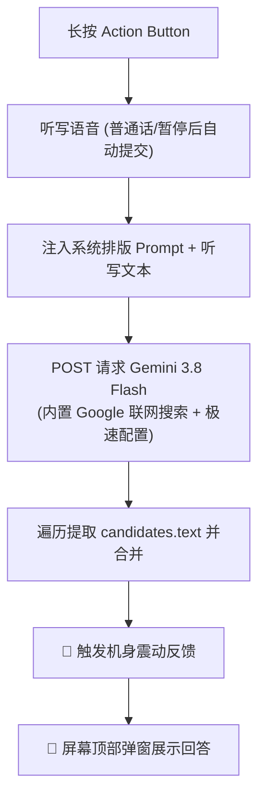

# iPhone 操作按钮（Action Button）随身 AI 快捷指令教程

通过 iPhone 机身侧边的操作按钮（Action Button），实现长按一键唤醒语音识别，自动调用 AI，并在屏幕顶部弹窗返回结果。

---

## 📱 适用机型
- **iPhone 17 全系列**、**iPhone 16 全系列**、**iPhone 15 Pro / Pro Max**（以及所有配备「操作按钮 Action Button」的机型）。

---

## 方案 1：ChatGPT 原生版

依托官方 ChatGPT App 动作，极简三步，专为 iOS 顶部弹窗优化排版。

### 1. 一键安装
👉 [📥 点击一键导入「ChatGPT 原生」快捷指令](https://www.icloud.com/shortcuts/31995a89ad594498a35264110bfc8a1e)

### 2. 指令配置与原图对照

  

- **听写文本**：停止聆听设为 **`暂停之后`**（说话停顿 1~2 秒自动提交）。
- **Ask ChatGPT**：
  - 传入 **`听写的文本`**
  - **Start new chat**：**开**（确保每次长按都是独立的新对话）
  - **Continuous chat**：**关**
  - **运行时显示**：**关**（后台静默运行，不弹出 ChatGPT 全屏界面）
- **显示**：关联 **`Ask ChatGPT`**（顶部卡片展示回答）

### 3. 绑定操作按钮（Action Button）
1. 打开 iPhone **「设置」**；
2. 进入 **「操作按钮」**（Action Button）；
3. 左右滑动至 **「快捷指令」** 选项；
4. 点击下方蓝色的 **「选取快捷指令…」**；
5. 勾选刚才导入的 **`ChatGPT 原生`**。

> **💡 首次使用提示**：
> 第一次长按操作按钮触发时，若弹出麦克风或网络访问提示，**请务必全部勾选「始终允许」**。

---

## 方案 2：Gemini 3.8 Flash 终极版（V1.1）

直接调用 Google Gemini 官方 API，响应速度极快，自带联网搜索。

### 1. 一键安装
👉 [📥 点击一键导入「gemini-3.8-flash-V1.1」快捷指令](https://www.icloud.com/shortcuts/1a90acf09c1147938418613cd734371e)

### 2. 工作流程与特性

- **⚡ Gemini 3.8 Flash 极速响应**：关闭思考延迟（`thinkingBudget: 0`），实现松手即答。
- **🌐 内置 Google Search 实时联网**：支持询问最新天气、即时新闻或实时数据。
- **📳 震动触感反馈**：模型生成完成瞬间震动一次，体验贴近 iOS 原生。
- **✨ 纯净跨设备通用（V1.1 特性）**：已移除私有备忘录依赖，任何 iPhone 导入后均可直接稳定运行，杜绝报错。

> **安装后的唯一修改项**：
> 导入快捷指令后，在 **「获取 URL 的内容」** 动作中，将 URL 末尾的 `key=...` 替换为你自己的 [Google AI Studio API Key](https://aistudio.google.com/)。

### 3. 绑定操作按钮（Action Button）
1. 打开 iPhone **「设置」**；
2. 进入 **「操作按钮」**（Action Button）；
3. 左右滑动至 **「快捷指令」** 选项；
4. 点击下方蓝色的 **「选取快捷指令…」**；
5. 勾选刚才导入的 **`gemini-3.8-flash-V1.1`**。

> **💡 首次使用提示**：
> 第一次长按操作按钮触发时，若弹出麦克风或网络访问提示，**请务必全部勾选「始终允许」**。
