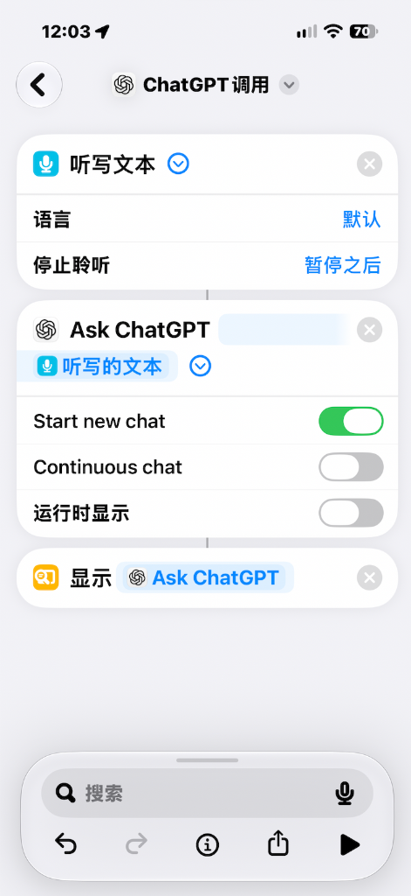
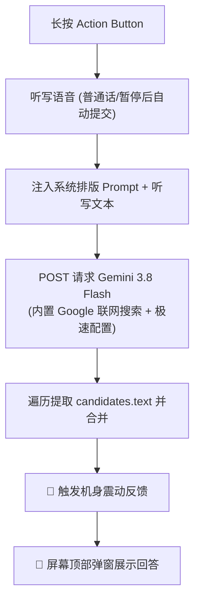

# iPhone 操作按钮（Action Button）随身 AI 快捷指令教程

通过 iPhone 机身侧边的操作按钮（Action Button），实现长按一键唤醒语音识别，自动调用 AI，并在屏幕顶部弹窗返回结果。

---

> ### 🛡️ 数据安全与隐私声明（请放心使用）
> 
> 本教程分享的所有快捷指令均遵循**绝对透明、本地直连**的安全原则，你可以完全放心导入使用：
> 1. **代码 100% 透明开源**：快捷指令纯由 iOS 原生动作构建，导入后你可以点击右上角 `...` 查看并审核其中的每一个动作，无任何隐藏脚本或后门；
> 2. **官方直连，绝无第三方服务器中转**：
>    - **方案 1（ChatGPT）**：仅通过系统权限唤起你本地安装的 OpenAI 官方 App；
>    - **方案 2（Gemini）**：由你的 iPhone 发起端到端加密请求（HTTPS）直接连接 Google 官方服务器（`generativelanguage.googleapis.com`），你的个人 API Key 与提问内容**绝不经过任何第三方转发或记录**；
> 3. **系统级沙盒保护**：语音识别调用的是 iOS 原生听写引擎，麦克风与网络访问严格受苹果系统级权限管控，你可以随时在系统设置中撤销权限。

---

## 📱 适用机型
- **iPhone 17 全系列**、**iPhone 16 全系列**、**iPhone 15 Pro / Pro Max**（以及所有配备「操作按钮 Action Button」的机型）。

---

## 🚀 快捷指令一键安装

无需手动一步步拼接复杂动作，在 iPhone 上使用 Safari 浏览器点击下方链接即可一键导入：

| 方案 | 快捷指令名称 | 特点与功能 | 一键获取链接 |
| :--- | :--- | :--- | :--- |
| **方案 1** | **ChatGPT 原生** | 依托官方 App，极简三步，专为 iOS 弹窗优化排版 | [📥 点击导入「ChatGPT 原生」](https://www.icloud.com/shortcuts/31995a89ad594498a35264110bfc8a1e) |
| **方案 2** | **gemini-3.8-flash-V1.1** | 官方 API 直连、**自带 Google 联网搜索**、震动触感反馈、零报错纯净开箱即用 | [📥 点击导入「gemini-3.8-flash-V1.1」](https://www.icloud.com/shortcuts/1a90acf09c1147938418613cd734371e) |

---

## 方案 1：ChatGPT 原生版

基于官方 ChatGPT App 动作，适合日常快速提问。

  

### 核心参数与逻辑：
- **听写文本**：停止聆听设为 **`暂停之后`**（说完停顿 1~2 秒自动提交，无需手动点击屏幕）。
- **Ask ChatGPT**：
  - 传入 **`听写的文本`**
  - **Start new chat**：**开**（确保每次长按都是独立的新对话）
  - **Continuous chat**：**关**
  - **运行时显示**：**关**（后台静默运行，不弹出 ChatGPT 全屏界面）
- **显示**：关联 **`Ask ChatGPT`**（顶部卡片展示回答）

---

## 方案 2：Gemini 3.8 Flash 终极版（V1.1 开箱即用版）

直接调用 Google Gemini 官方 API，响应速度极快，功能强大。

### 核心亮点：
1. **⚡ Gemini 3.8 Flash 极速响应**：关闭思考延迟（`thinkingBudget: 0`），实现松手即答。
2. **🌐 内置 Google Search 实时联网**：支持询问最新天气、即时新闻或实时数据。
3. **📳 震动触感反馈**：模型生成完成瞬间震动一次，体验贴近 iOS 原生。
4. **✨ 纯净跨设备通用（V1.1 特性）**：已移除特定私有备忘录文件夹依赖，任何 iPhone 导入后均可直接稳定运行，杜绝报错。

> **安装后的唯一修改项**：
> 导入快捷指令后，在 **「获取 URL 的内容」** 动作中，将 URL 末尾的 `key=...` 替换为你自己的 [Google AI Studio API Key](https://aistudio.google.com/)。

---

## ⚙️ 绑定操作按钮（Action Button）

1. 打开 iPhone **「设置」**。
2. 进入 **「操作按钮」**（Action Button）。
3. 左右滑动至 **「快捷指令」** 选项。
4. 点击下方蓝色的 **「选取快捷指令…」**。
5. 勾选刚才导入的 **`ChatGPT 原生`** 或 **`gemini-3.8-flash-V1.1`**。

---

### 💡 首次使用提示
第一次长按操作按钮触发时，如果屏幕上方弹出麦克风或网络访问提示，**请务必全部勾选「始终允许」**。之后即可享受完全无感、长按即问的随身 AI 体验！
